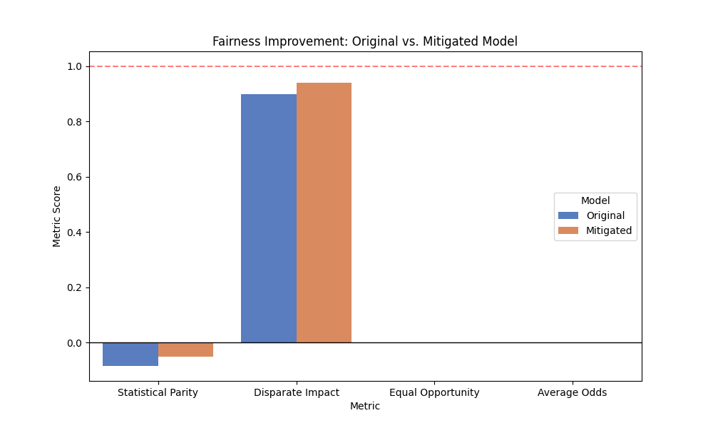
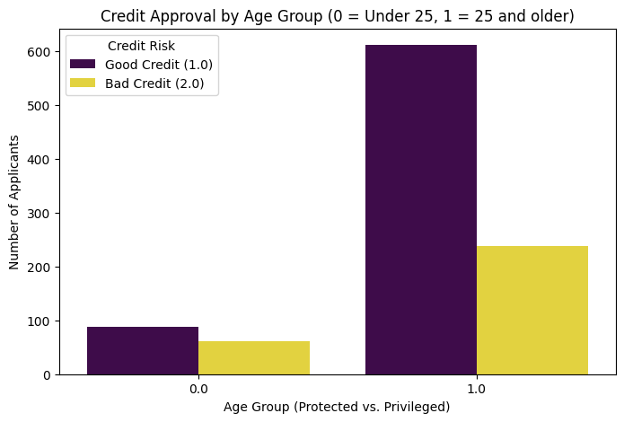
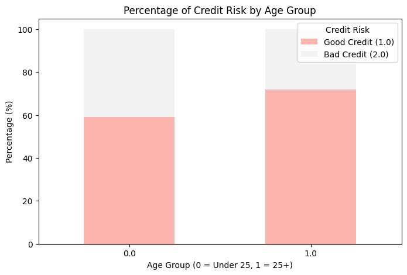

# Credit Scoring Fairness Audit with IBM AIF360

An end-to-end fairness audit of a credit-risk classifier on the **German Credit** dataset. It measures
whether the model treats young applicants (under 25) differently from older ones, then reduces the bias
with **reweighing** at almost no cost in accuracy.

## Results

The protected attribute is **age**. The privileged group is 25 and older; the unprivileged group is under 25.

| Metric | Ideal | Original model | After reweighing |
|---|---|---|---|
| Statistical Parity Difference | 0 | −0.085 | **−0.050** |
| Disparate Impact | 1.0 | 0.899 | **0.940** |
| Accuracy | – | 0.763 | 0.760 |

- Before mitigation, young applicants were approved **75.0%** of the time vs **83.5%** for older applicants.
- Reweighing cut the statistical parity gap by **~41%** and moved disparate impact well above the
  0.8 "four-fifths rule" threshold, for a 0.3-point drop in accuracy.
- On the original model, Equal Opportunity Difference was −0.015 and Average Odds Difference −0.067. The true-positive
  rates are already close; most of the gap is in who gets approved at all.

Baseline model performance: accuracy 0.763, precision 0.781, recall 0.919, F1 0.844, ROC-AUC 0.804.



## Method

1. **Exploratory analysis.** Distributions, correlations, and approval rates by age group.
2. **Baseline model.** Random forest classifier on standardised features, with a 70/30 train-test split.
3. **Fairness metrics.** Statistical parity difference, disparate impact, equal opportunity difference,
   and average odds difference, computed overall and per group.
4. **Mitigation.** AIF360's `Reweighing` pre-processing assigns sample weights so that outcome and
   protected group are independent in the training data. The model is then retrained.
5. **Trade-off analysis.** Fairness gains vs accuracy loss, plus deployment and monitoring considerations
   (covered in the report).

<p float="left">
  
  
</p>

## Files

| File | Contents |
|---|---|
| `credit_fairness_analysis.ipynb` | Full analysis: EDA, model, fairness metrics, mitigation |
| `report.pdf` | Written report: socio-technical context, methodology, results, MLOps considerations |
| `figures/` | Plots from the analysis |

## Run it

```bash
pip install -r requirements.txt
jupyter notebook credit_fairness_analysis.ipynb
```

**Stack:** IBM AIF360 · scikit-learn · pandas · NumPy · matplotlib · seaborn

---
Abrham Yilma · Built during my MSc at Addis Ababa University
